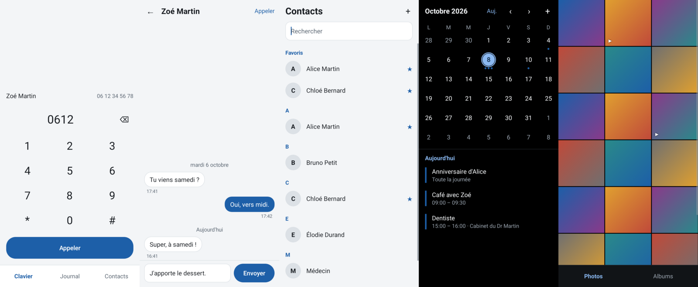

# Applis sobres

Neuf petites applis Android de base, faites pour consommer le moins possible : mémoire, batterie, place.

| Appli | Fichier | Ce qu'elle fait |
|---|---|---|
| Téléphone | `telephone.apk` | Clavier, journal d'appels avec les noms, contacts et favoris, recherche en tapant |
| Messages | `messages.apk` | Conversations SMS, lecture, envoi (y compris longs), nouveau message vers un contact |
| Contacts | `contacts.apk` | Liste avec recherche, fiche, ajout, modification, suppression, favoris |
| Calculatrice | `calculatrice.apk` | Quatre opérations, parenthèses, pourcentage, derniers calculs |
| Notes | `notes.apk` | Notes en texte, recherche, partage ; enregistrement automatique |
| Galerie | `galerie.apk` | Photos et vidéos par date et par album, plein écran avec zoom, partage, suppression |
| Appareil photo | `appareil.apk` | Photo, flash, caméra avant ou arrière, zoom |
| Fichiers | `fichiers.apk` | Parcourir, ouvrir, copier, déplacer, renommer, supprimer, nouveau dossier, tri |
| Calendrier | `calendrier.apk` | Mois et journée, agendas du téléphone, événements simples ou répétés, rappels |

Chaque APK pèse entre 31 et 47 Ko. Android 8 minimum.



*Images produites dans un simulateur, avec des données d'exemple.*

## Téléchargement

[Dernière version](https://github.com/ManBoyx/applis-sobres/releases/latest) : un fichier `.apk` par appli.

## Ce qui les rend sobres

- Java natif, **aucune bibliothèque**, pas de navigateur intégré.
- **Aucun service en arrière-plan**, rien au démarrage du téléphone. Une appli fermée ne fait rien.
  Seule exception : le Calendrier est réveillé par le téléphone à l'heure d'un rappel, le temps d'afficher la notification.
- Un écran ne lit ses données et ne s'abonne à leurs changements que tant qu'il est visible.
- Les listes ne gardent en mémoire que ce qui est à l'écran ; la Galerie plafonne ses vignettes à 6 Mo et ne tient qu'une grande image à la fois.
- **Aucune appli ne demande l'accès à Internet.** Rien ne sort du téléphone.
- Fond noir en thème sombre : sur un écran OLED, un pixel noir est un pixel éteint.

## Installation

Copier les `.apk` sur le téléphone et les ouvrir. Android demande d'autoriser l'installation depuis cette source.

Chaque appli explique pourquoi elle demande une autorisation, au moment où elle en a besoin.

Sur **Android 15**, une appli installée hors du Play Store peut voir les autorisations SMS ou journal d'appels grisées. Il faut alors ouvrir la fiche de l'appli dans les réglages, appuyer sur les trois points en haut à droite et choisir « Autoriser les paramètres restreints ».

**Fichiers** a besoin de « l'accès à tous les fichiers », un réglage que seul l'utilisateur peut activer : l'appli y conduit.

## Limites à connaître

- **Téléphone** et **Messages** fonctionnent *à côté* des applis d'origine, ils ne les remplacent pas.
  - L'écran pendant un appel reste celui du téléphone.
  - Messages lit et envoie les SMS, mais c'est l'appli d'origine qui les reçoit et notifie. Pas de MMS (photos, groupes), pas de suppression de message.
  - Le compteur de non-lus est celui du téléphone : il ne baisse que quand l'appli d'origine marque les messages comme lus.
- **Appareil photo** : photo seulement, pas de vidéo.
- **Galerie** : les vidéos s'ouvrent dans le lecteur du téléphone. Pas de retouche.
- **Fichiers** : pas de corbeille, une suppression est définitive. Pas d'archives zip.
- **Calendrier** : modifier ou supprimer un événement répété porte sur toute la série. Si une autre appli d'agenda est installée, un rappel peut s'afficher deux fois.
- **Contacts** : pas de photo de contact, pas de fusion de doublons.
- **Notes** : les notes vivent dans le dossier privé de l'appli. Désinstaller l'appli les efface.

## État

Vérifié par 343 tests automatiques, dont les écrans pilotés dans un simulateur Android, et par des images de chaque écran.

**Pas encore essayé sur un vrai téléphone.** Les appels, l'envoi de SMS, l'appareil photo réel et les demandes d'autorisation n'ont pas pu être vérifiés sans appareil. L'accès à l'appareil photo, en particulier, n'est couvert par aucun test.

## Compilation

```
ANDROID_HOME=~/android-sdk ./gradlew :contacts:assembleRelease     # une appli
ANDROID_HOME=~/android-sdk ./gradlew assembleRelease               # toutes
```

Les APK sortent dans `<appli>/build/outputs/apk/release/`. Ils sont signés si `signature/sobre.jks` et `signature/cle.properties` existent. Cette clé n'est pas dans le dépôt : sans elle, une mise à jour ne s'installe pas par-dessus la version précédente.

Pour une nouvelle version d'une appli, augmenter son numéro dans la table `versions` de `build.gradle`.

## Tests

```
./tests.sh contacts                                                # la logique seule, en quelques secondes
ANDROID_HOME=~/android-sdk ./gradlew :contacts:testDebugUnitTest   # avec les écrans
ANDROID_HOME=~/android-sdk ./gradlew :contacts:testDebugUnitTest -Dcaptures.dir=$PWD/captures   # et les images
```

## Organisation

| Dossier | Rôle |
|---|---|
| `commun/` | Le socle partagé : thème, éléments d'écran, navigation entre écrans, dates, numéros, recherche |
| `essais/` | Outils des tests : appuyer sur un texte, lire l'écran, prendre une image, fausse base de données |
| `<appli>/` | Une appli. La logique pure est dans `logique/`, l'accès au téléphone derrière une interface `Depot` |

Chaque appli n'a qu'une activité, qui montre un écran à la fois. Les écrans sont construits en Java, sans fichier de mise en page à lire.
